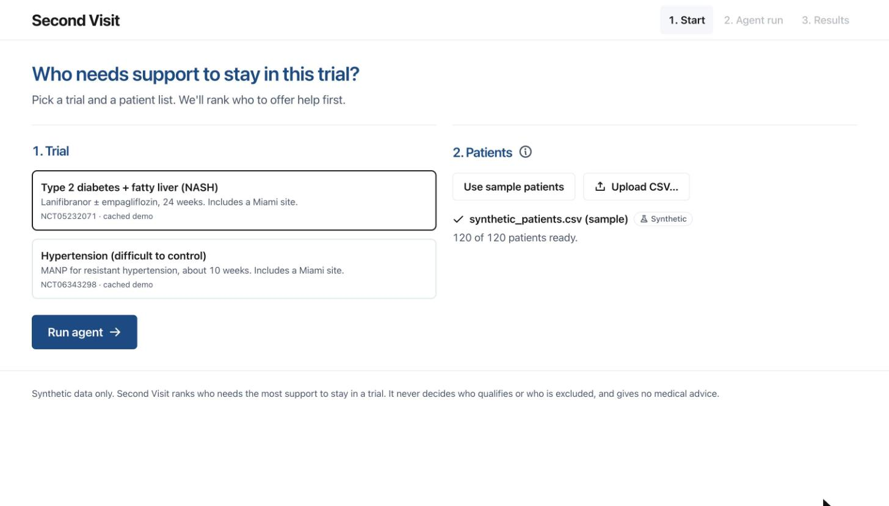
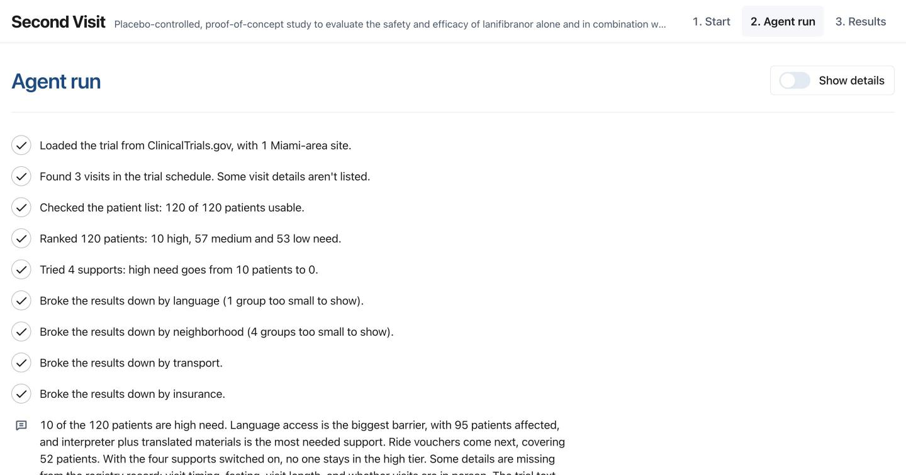
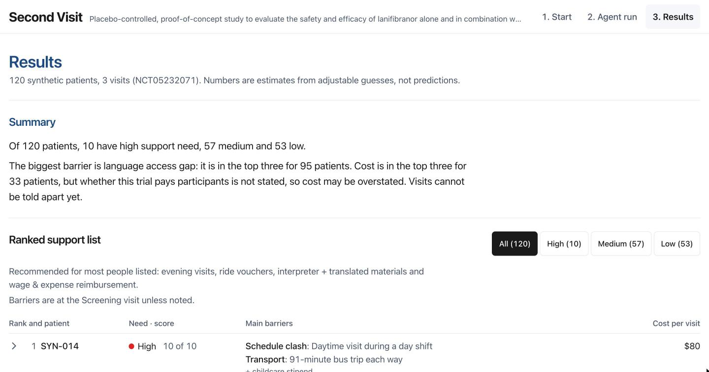
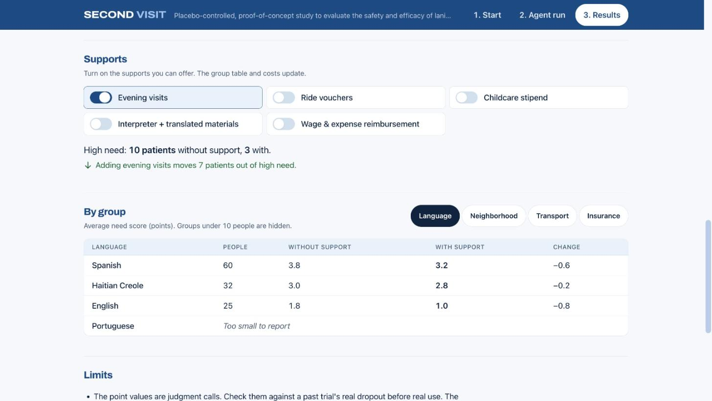

# Second Visit

> A retention-support agent for clinical trial teams in Miami-Dade: it reads a real trial's visit schedule, scores the barriers each already-eligible patient would face at the trial's visits, and ranks who should be offered support first.

Miami AI-agent hackathon · Health & Wellbeing track.

## Team

- Brandon Heller
- Girish Raju
- Mateo Gomez-Peck

## The idea

People who qualify for a trial still drop out when visits clash with night shifts, need two buses each way, cost a day's pay, have no childcare, or come with forms in a language they don't read. A research team uploads a CSV of **synthetic, de-identified** patients who are **already medically eligible**. The agent fetches the trial from ClinicalTrials.gov, extracts the visit schedule, scores each patient's barriers as points, simulates supports (evening visits, ride vouchers, childcare stipend, interpreter + translated materials, wage & expense reimbursement), and summarizes by group.

**The score decides who gets help first. It is never used to exclude, deprioritize or reject anyone.** It never decides medical eligibility and gives no medical advice.

## Demo

Screens from a real run on the diabetes/fatty-liver demo trial (NCT05232071) with the 120 sample patients. All patients are synthetic.

**1. Start.** Pick a trial and a patient list.



**2. Agent run.** Each tool call streams in as one plain sentence: fetch the trial, read the visit schedule, check the patient list, rank patients, try supports, break results down by group. Claude closes with a short summary.



**3. Results.** The summary is written in code from the numbers, not by the model. Below it, the ranked support list shows who to offer help first and why.



**4. Supports.** Turn supports on and off. Each switch says what it did for the people at high need, and the group table updates.



## Stack

Next.js 15 (App Router) + TypeScript + Tailwind 4. Anthropic SDK (`@anthropic-ai/sdk`) for the agent, called from server routes only. Vitest for unit tests. No database.

## Running locally

Needs Node 20+ and an Anthropic API key.

```bash
npm install
cp .env.example .env.local   # then set ANTHROPIC_API_KEY and ANTHROPIC_MODEL
npm run dev                  # http://localhost:3000
npm test                     # scoring unit tests
npm run build                # run before pushing; must pass
```

| Env var | Required | What it is |
| --- | --- | --- |
| `ANTHROPIC_API_KEY` | yes | Anthropic API key. Server-side only. |
| `ANTHROPIC_MODEL` | yes | Claude model id for the agent loop and schedule extraction, e.g. `claude-opus-5-5` or `claude-sonnet-5-5`. Not hardcoded anywhere. |

Without these the app still loads; **Run agent** reports which variable is missing.

Demo path: **Start** → pick the diabetes/fatty-liver demo trial → **Use sample patients** → **Run agent** → watch the steps stream in → **Results** (toggle supports, edit assumptions).

## How the agent works

`POST /api/run` (`app/api/run/route.ts`) runs a real tool-use loop (`lib/agent/loop.ts`): it sends the messages and tool definitions to Claude, runs whatever tools Claude asks for in code, sends the results back, and repeats, capped at 12 iterations. Each step streams to the UI as newline-delimited JSON (step id, tool, status, one-line summary, tool input/output). Tool errors go back to Claude as `is_error` results; the prompt tells it to retry once or continue with the part flagged unknown, never to invent data. The run ends when Claude gives its short closing summary.

| Tool | How it runs |
| --- | --- |
| `fetch_trial(nct_id)` | Code. `GET https://clinicaltrials.gov/api/v2/studies/{nctId}` (field paths verified against a live response, see `lib/agent/trial.ts`). On failure uses `/data/trials/{nctId}.json` and says it used a cached copy. |
| `extract_visit_schedule` | Claude, structured output. Unstated fields come back as `"unknown"`. If there is no schedule, the UI asks for pasted protocol text and re-runs. |
| `parse_patients` | Code. Validates against `/data/patient_schema.ts`; rejects files with name, phone, email, address, DOB, SSN, MRN or similar columns. Returns counts only. |
| `score_patients` | Code (`lib/scoring/score.ts`). |
| `simulate_supports` | Code (`lib/scoring/simulate.ts`). |
| `summarize_groups` | Code. Groups under 10 people → "Too small to report". |

The patient CSV is held in memory for the request and never written to disk or logged. Claude never sees patient rows.

## The algorithm

A **points score**, the same pattern as clinical risk scores: each barrier a patient has adds fixed points, counted once however many visits it affects, and the total sets the need level.

| Barrier | Points | Counts when |
|---|---|---|
| Schedule clash | 3 | Morning or fasting visit after a night or irregular shift; a daytime visit for a day-shift worker with no time off; visits over 3 hours |
| Transport | 2 | Bus/Metrorail only and 40+ minutes each way; family ride over 60 minutes |
| Childcare | 2 | Children under 6 and no childcare |
| Language access | 2 | The trial's materials are not offered in the person's language (a gap in the trial, not a trait of the person) |
| Cost | 1 | Fare or mileage plus parking, lost pay and uninsured costs, minus what the trial pays, reach half of a household's spare budget per visit |
| Missed appointments | 1 | Off by default because it can encode socioeconomic bias |

**Need score = sum of points** (out of 10 by default). **High 6+, Medium 3-5, Low 0-2.** Supports remove the barriers they address and the simulation re-scores, so Results shows how many patients sit at each need level without and with supports. Race, ethnicity and immigration status are not inputs; neighborhood is used only for group reporting. All points and cutoffs live in `lib/assumptions.ts` and can be edited in the UI.

## Limitations

- **The point values are judgment calls, not validated.** Check them against a past trial's real dropout before any real use.
- The score says who needs support most; it is not a predicted chance of dropping out.
- Registry records rarely give visit times, durations or fasting; those show as "unknown". Unknown time of day is not scored as a morning clash, so need may be understated; unknown duration uses an assumed length; unknown in-person status is scored as in person.
- The data has no paid-leave column; the default assumes hourly workers lose pay for daytime visits.
- Synthetic demo data only. No medical questions are answered: talk to a clinician, or call 911 in an emergency.

## Responsible AI

Synthetic demo data only · uploads must be de-identified, and identifying columns are rejected · rows are never stored or logged · the LLM sees aggregates and patient IDs only · no eligibility decisions · no medical answers · groups under 10 suppressed · limitations box in the UI.
